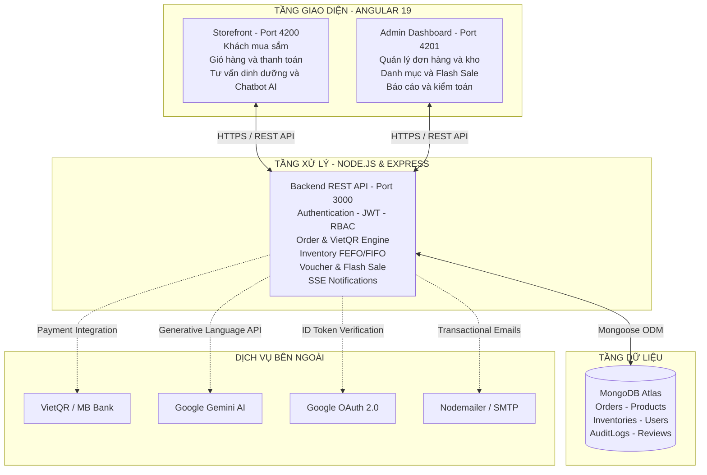

# Evergreen Mart (Nutrious-Web)
### Nền tảng thương mại điện tử thực phẩm sạch và dinh dưỡng thông minh
---

## Giới thiệu dự án

**Evergreen Mart (Nutrious-Web)** là dự án đồ án môn học **Phát triển Web Kinh doanh Nâng cao** - Trường Đại học Kinh tế - Luật (UEL), Đại học Quốc gia TP.HCM.

Dự án xây dựng nền tảng thương mại điện tử chuyên cung cấp thực phẩm hữu cơ, nông sản tươi sống và các giải pháp dinh dưỡng cá nhân hóa, hướng đến việc nâng cao trải nghiệm mua sắm và hỗ trợ người dùng lựa chọn thực phẩm phù hợp với nhu cầu.

Hệ thống tích hợp các công nghệ và giải pháp nổi bật:

- **Smart Grocery Shopping:** Tìm kiếm, lọc và lựa chọn thực phẩm theo đặc tính dinh dưỡng.
- **Automated VietQR Payment:** Tạo mã QR thanh toán động, đối soát đơn hàng và quản lý thời hạn thanh toán.
- **Smart Inventory Management:** Quản lý tồn kho theo lô hàng và hạn sử dụng với nguyên tắc FEFO/FIFO.
- **AI Nutrition Assistant:** Trợ lý AI hỗ trợ tư vấn dinh dưỡng và gợi ý món ăn.
- **Business Administration:** Quản lý vận hành, đơn hàng, kho hàng, khuyến mãi và phân tích kinh doanh.

---

## Mục lục

1. [Kiến trúc hệ thống](#1-kiến-trúc-hệ-thống)
2. [Cấu trúc thư mục](#2-cấu-trúc-thư-mục)
3. [Cài đặt và khởi chạy](#3-cài-đặt-và-khởi-chạy)
   - [Yêu cầu hệ thống](#31-yêu-cầu-hệ-thống)
   - [Khởi chạy Backend REST API](#32-khởi-chạy-backend-rest-api)
   - [Khởi chạy Storefront](#33-khởi-chạy-storefront)
   - [Khởi chạy Admin Dashboard](#34-khởi-chạy-admin-dashboard)
   - [Tổng hợp cổng dịch vụ](#35-tổng-hợp-cổng-dịch-vụ)
4. [Các tính năng nổi bật](#4-các-tính-năng-nổi-bật)
5. [Công nghệ sử dụng](#5-công-nghệ-sử-dụng)
6. [Tài liệu dự án](#6-tài-liệu-dự-án)

---

## 1. Kiến trúc hệ thống
### 1.1. Sơ đồ kiến trúc tổng thể



### 1.2. Các thành phần kiến trúc

| Thành phần     | Công nghệ             | Vai trò                                                             |
| -------------- | --------------------- | ------------------------------------------------------------------- |
| Storefront     | Angular 19            | Giao diện dành cho khách hàng mua sắm và sử dụng dịch vụ dinh dưỡng |
| Admin Portal   | Angular 19            | Giao diện quản trị và vận hành hệ thống                             |
| Backend API    | Node.js, Express.js   | Xử lý nghiệp vụ, xác thực, phân quyền và cung cấp REST API          |
| Database       | MongoDB Atlas         | Lưu trữ dữ liệu người dùng, sản phẩm, đơn hàng và tồn kho           |
| Payment        | VietQR                | Tạo mã thanh toán và hỗ trợ xử lý giao dịch                         |
| AI Service     | Google Gemini AI      | Hỗ trợ chatbot và tư vấn dinh dưỡng                                 |
| Authentication | JWT, Google OAuth 2.0 | Xác thực người dùng và kiểm soát quyền truy cập                     |
| Email Service  | Nodemailer / SMTP     | Gửi hóa đơn và thông báo qua email                                  |

---

## 2. Cấu trúc thư mục

Dự án được tổ chức thành ba phân hệ chính: Backend, Storefront và Admin Portal, cùng với các thư mục tài liệu và cấu hình dự án.

```text
Nutrious-Web/
│
├── service/                         # Backend REST API
│   ├── data/                        # Mock data và dữ liệu cấu hình
│   ├── middleware/                  # Authentication, authorization,
│   │                                # upload và error handling
│   ├── models/                      # Mongoose Schemas
│   ├── routes/                      # API routes và xử lý nghiệp vụ
│   ├── scripts/                     # Scripts hỗ trợ dữ liệu
│   ├── utils/                       # Utilities: shipping, voucher,
│   │                                # VietQR, email, SSE
│   ├── .env.example                 # Mẫu biến môi trường
│   ├── index.js                     # Backend entry point
│   ├── package.json
│   └── seed-data.js                 # Khởi tạo dữ liệu mẫu
│
├── my-app/                          # Storefront - Angular 19
│   ├── public/                      # Logo, icons, banners
│   ├── src/
│   │   ├── app/
│   │   │   ├── components/          # Shared UI components
│   │   │   ├── models/              # TypeScript interfaces
│   │   │   ├── pages/
│   │   │   │   ├── home/            # Trang chủ
│   │   │   │   ├── catalog/         # Danh mục sản phẩm
│   │   │   │   ├── product-detail/  # Chi tiết sản phẩm
│   │   │   │   ├── cart/            # Giỏ hàng
│   │   │   │   ├── checkout/        # Đặt hàng và thanh toán
│   │   │   │   ├── order-detail/    # Chi tiết đơn hàng
│   │   │   │   ├── tracker/         # Tra cứu đơn hàng
│   │   │   │   ├── account/         # Quản lý tài khoản
│   │   │   │   ├── nutrition/       # Tư vấn dinh dưỡng
│   │   │   │   ├── cook/            # Công thức nấu ăn
│   │   │   │   └── vouchers/        # Voucher và khuyến mãi
│   │   │   ├── shared/              # Pipes, directives, guards,
│   │   │   │                        # interceptors
│   │   │   ├── app.config.ts
│   │   │   └── app.routes.ts
│   │   ├── index.html
│   │   └── styles.css
│   ├── angular.json
│   └── package.json
│
├── admin/                           # Admin Portal - Angular 19
│   ├── public/
│   ├── src/
│   │   ├── app/
│   │   │   ├── admin/
│   │   │   │   ├── dashboard/       # Tổng quan kinh doanh
│   │   │   │   ├── orders/          # Quản lý đơn hàng
│   │   │   │   ├── products/        # Quản lý sản phẩm
│   │   │   │   ├── inventory/       # Quản lý tồn kho
│   │   │   │   ├── vouchers/        # Voucher và Flash Sale
│   │   │   │   ├── reviews/         # Kiểm duyệt đánh giá
│   │   │   │   ├── complaints/      # Quản lý khiếu nại
│   │   │   │   ├── analytics/       # Phân tích kinh doanh
│   │   │   │   ├── audit-log/       # Nhật ký kiểm toán
│   │   │   │   └── layout/          # Sidebar, Navbar, Header
│   │   │   ├── shared/              # Services, Guards, Interceptors
│   │   │   └── app.routes.ts
│   ├── angular.json
│   └── package.json
│
├── docs/                            # Tài liệu phân tích và thiết kế
│   └── EVERGREENMART_BUSINESS_RULES_SPECIFICATION_DRAFT.md
│
├── AGENTS.md                        # Quy ước coding
├── SETUP.md                         # Hướng dẫn thiết lập môi trường
├── TEAM_WORKFLOW.md                 # Quy trình làm việc nhóm
└── README.md                        # Tổng quan dự án
```

---

## 3. Cài đặt và khởi chạy

Evergreen Mart bao gồm ba ứng dụng độc lập. Để vận hành toàn bộ hệ thống, cần khởi chạy Backend, Storefront và Admin Portal trong ba cửa sổ Terminal riêng biệt.

### 3.1. Yêu cầu hệ thống

| Công cụ       | Phiên bản yêu cầu   | Mục đích                       |
| ------------- | ------------------- | ------------------------------ |
| Node.js       | 18.x hoặc 20.x LTS  | Backend runtime                |
| npm           | 9.x trở lên         | Quản lý dependencies           |
| Angular CLI   | 19.x                | Khởi chạy Angular applications |
| MongoDB Atlas | Cloud Database      | Lưu trữ dữ liệu                |
| Git           | Phiên bản hiện hành | Quản lý mã nguồn               |

Cài đặt Angular CLI:

```bash
npm install -g @angular/cli
```

### 3.2. Khởi chạy Backend REST API

**Thư mục:** `service/`
**Port:** `3000`

Backend chịu trách nhiệm xử lý logic nghiệp vụ, kết nối cơ sở dữ liệu và cung cấp API cho hai ứng dụng Frontend.

**Bước 1. Di chuyển vào thư mục Backend**

```bash
cd service
```

**Bước 2. Cài đặt dependencies**

```bash
npm install
```
**Bước 3. Khởi chạy Backend**

Chế độ phát triển (khuyến nghị):

```bash
npm run dev
```

Chế độ thông thường:

```bash
npm start
```

Sau khi khởi chạy thành công, Backend API hoạt động tại:

- API Server: `http://localhost:3000`
- Products API: `http://localhost:3000/api/products`

### 3.3. Khởi chạy Storefront

**Thư mục:** `my-app/`
**Port:** `4200`

Storefront là giao diện dành cho khách hàng, hỗ trợ tìm kiếm, mua sắm thực phẩm, thanh toán và sử dụng các tính năng tư vấn dinh dưỡng.

**Bước 1. Di chuyển vào thư mục**

```bash
cd my-app
```

**Bước 2. Cài đặt dependencies**

```bash
npm install
```

**Bước 3. Khởi chạy ứng dụng**

```bash
npm start
```

Hoặc sử dụng Angular CLI:

```bash
ng serve --port 4200
```

**Bước 4. Truy cập ứng dụng**

Mở trình duyệt tại:

`http://localhost:4200`

### 3.4. Khởi chạy Admin Dashboard

**Thư mục:** `admin/`
**Port:** `4201`

Admin Dashboard cung cấp giao diện quản trị dành cho nhân viên và quản trị viên, hỗ trợ quản lý đơn hàng, sản phẩm, kho hàng và hoạt động kinh doanh.

**Bước 1. Di chuyển vào thư mục**

```bash
cd admin
```

**Bước 2. Cài đặt dependencies**

```bash
npm install
```

**Bước 3. Khởi chạy ứng dụng**

```bash
npm start
```

Hoặc sử dụng Angular CLI:

```bash
ng serve --port 4201
```

**Bước 4. Truy cập ứng dụng**

Mở trình duyệt tại:

`http://localhost:4201`

### 3.5. Tổng hợp cổng dịch vụ

Sau khi khởi chạy thành công cả ba ứng dụng, hệ thống hoạt động trên các cổng mặc định sau:

| Phân hệ      | Thư mục    | Port | Địa chỉ truy cập        | Lệnh khởi chạy |
| ------------ | ---------- | ---: | ----------------------- | -------------- |
| Backend API  | `service/` | 3000 | `http://localhost:3000` | `npm run dev`  |
| Storefront   | `my-app/`  | 4200 | `http://localhost:4200` | `npm start`    |
| Admin Portal | `admin/`   | 4201 | `http://localhost:4201` | `npm start`    |

> **Quan trọng:** Cần khởi chạy Backend trước khi sử dụng Storefront và Admin Portal để đảm bảo các ứng dụng Frontend có thể kết nối và trao đổi dữ liệu với hệ thống API.

---

## 4. Các tính năng nổi bật
### 4.1. Customer Storefront – Phân hệ khách hàng

| Tính năng                       | Mô tả                                                                                 |
| ------------------------------- | ------------------------------------------------------------------------------------- |
| Danh mục và tìm kiếm thông minh | Tìm kiếm, lọc sản phẩm theo danh mục, giá bán, đặc tính dinh dưỡng và chứng nhận xanh |
| Thanh toán VietQR động          | Tự động tạo mã QR theo số tiền và mã đơn hàng, thiết lập thời hạn thanh toán 15 phút  |
| Quản lý thời hạn thanh toán     | Tự động xử lý đơn quá hạn và hoàn trả tồn kho theo quy tắc nghiệp vụ                  |
| Thanh toán COD                  | Hỗ trợ thanh toán khi nhận hàng và áp dụng quy chế xử lý đơn thực phẩm tươi sống      |
| Khuyến mãi đa tầng              | Kết hợp voucher giảm giá đơn hàng, mã miễn phí vận chuyển và Flash Sale               |
| Trợ lý dinh dưỡng AI            | Sử dụng Google Gemini AI để hỗ trợ tư vấn khẩu phần, Eat Clean, Keto và gợi ý món ăn  |
| Theo dõi đơn hàng               | Tra cứu trạng thái đơn hàng: `pending`, `confirmed`, `shipping`, `delivered`          |
| Quản lý tài khoản               | Quản lý hồ sơ cá nhân, địa chỉ nhận hàng và sổ điểm thưởng                            |
| Sổ tay nấu ăn                   | Tham khảo công thức và gợi ý chế biến các món ăn dinh dưỡng                           |
| Ví voucher                      | Quản lý các mã giảm giá và chương trình ưu đãi cá nhân                                |

### 4.2. Admin Dashboard – Phân hệ quản trị

| Tính năng                 | Mô tả                                                                        |
| ------------------------- | ---------------------------------------------------------------------------- |
| Dashboard tổng quan       | Theo dõi doanh thu, số lượng đơn hàng và khách hàng mới                      |
| Quản lý đơn hàng          | Kiểm tra, xác nhận thanh toán và cập nhật trạng thái đơn hàng                |
| Quản lý sản phẩm          | Thêm, sửa, xóa sản phẩm và cấu hình thông tin dinh dưỡng                     |
| Quản lý tồn kho FEFO/FIFO | Quản lý nhập, xuất, tồn theo lô hàng và hạn sử dụng                          |
| Stock Adjustment Ticket   | Lập phiếu điều chỉnh tồn kho và ghi nhận các thay đổi                        |
| Marketing và Flash Sale   | Thiết lập chương trình khuyến mãi, khung giờ và giới hạn số lượng            |
| Quản lý đánh giá          | Kiểm duyệt đánh giá và theo dõi phản hồi của khách hàng                      |
| Quản lý khiếu nại         | Tiếp nhận và xử lý các vấn đề phát sinh từ khách hàng                        |
| Business Analytics        | Phân tích doanh thu, sản phẩm bán chạy và tỷ lệ hủy đơn                      |
| Xuất báo cáo              | Hỗ trợ xuất dữ liệu Excel (`.xlsx`) và CSV (`.csv`)                          |
| Audit Log                 | Ghi nhận các thao tác chỉnh sửa giá, hủy đơn và điều chỉnh kho của nhân viên |

---

## 5. Công nghệ sử dụng

| Hạng mục                | Công nghệ                  | Vai trò                                   |
| ----------------------- | -------------------------- | ----------------------------------------- |
| Frontend Framework      | Angular 19                 | Xây dựng giao diện Storefront và Admin    |
| Programming Language    | TypeScript 5.6             | Phát triển ứng dụng Frontend              |
| UI & Styling            | Vanilla CSS3, SVG          | Thiết kế giao diện và responsive          |
| State & Reactive        | Angular Signals, RxJS 7.8  | Quản lý trạng thái và xử lý luồng dữ liệu |
| Form Handling           | Reactive Forms             | Xây dựng và kiểm soát biểu mẫu            |
| Backend Runtime         | Node.js 18+/20+            | Môi trường thực thi Backend               |
| Backend Framework       | Express.js 4.19            | Xây dựng REST API                         |
| Database                | MongoDB Atlas              | Lưu trữ dữ liệu                           |
| ODM                     | Mongoose 8.5               | Tương tác với MongoDB                     |
| Authentication          | JWT, bcryptjs              | Xác thực và bảo mật tài khoản             |
| Social Login            | Google OAuth 2.0           | Đăng nhập bằng Google                     |
| Payment Integration     | VietQR Open API            | Tạo mã QR thanh toán                      |
| Artificial Intelligence | Google Gemini AI SDK       | Tích hợp trợ lý AI                        |
| Maps & Location         | Leaflet 1.9, OpenStreetMap | Hiển thị bản đồ và vị trí                 |
| File Processing         | ExcelJS, SheetJS (XLSX)    | Xử lý dữ liệu và xuất báo cáo             |
| Email Service           | Nodemailer, SMTP           | Gửi email thông báo                       |

---

## 6. Tài liệu dự án

Các tài liệu hỗ trợ quá trình thiết lập, phát triển và vận hành hệ thống:

| Tài liệu                                                                                                               | Nội dung                                                |
| ---------------------------------------------------------------------------------------------------------------------- | ------------------------------------------------------- |
| [`SETUP.md`](SETUP.md)                                                                                                 | Hướng dẫn thiết lập môi trường và kết nối MongoDB Atlas |
| [`TEAM_WORKFLOW.md`](TEAM_WORKFLOW.md)                                                                                 | Quy trình làm việc nhóm, Git Branch và Pull Request     |
| [`AGENTS.md`](AGENTS.md)                                                                                               | Quy ước coding và hướng dẫn dành cho Agent              |
| [`docs/EVERGREENMART_BUSINESS_RULES_SPECIFICATION_DRAFT.md`](docs/EVERGREENMART_BUSINESS_RULES_SPECIFICATION_DRAFT.md) | Đặc tả quy tắc nghiệp vụ của Evergreen Mart             |

---
