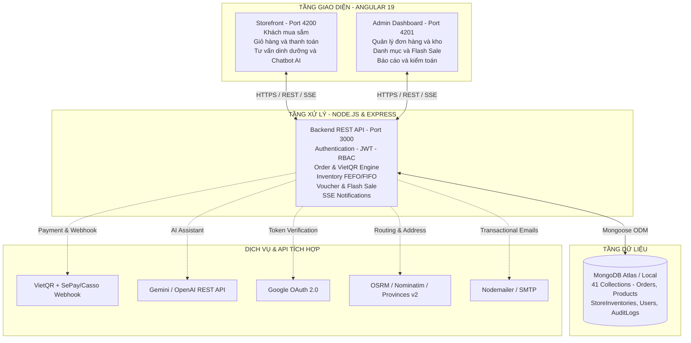

# Evergreen Mart (Nutrious-Web)
### Nền tảng thương mại điện tử thực phẩm sạch và dinh dưỡng thông minh
---

## Giới thiệu dự án

**Evergreen Mart (Nutrious-Web)** là dự án đồ án môn học **Phát triển Web Kinh doanh Nâng cao** - Trường Đại học Kinh tế - Luật (UEL), Đại học Quốc gia TP.HCM.

Dự án xây dựng nền tảng thương mại điện tử chuyên cung cấp thực phẩm hữu cơ, nông sản tươi sống và các giải pháp dinh dưỡng cá nhân hóa, hướng đến việc nâng cao trải nghiệm mua sắm và hỗ trợ người dùng lựa chọn thực phẩm phù hợp với nhu cầu.

Hệ thống tích hợp các công nghệ và giải pháp nổi bật:

- **Smart Grocery Shopping:** Tìm kiếm, lọc và lựa chọn thực phẩm theo đặc tính dinh dưỡng.
- **Automated VietQR Payment:** Tạo mã QR thanh toán động, đối soát đơn hàng và quản lý thời hạn thanh toán.
- **Smart Inventory Management:** Quản lý tồn kho theo lô hàng và hạn sử dụng với nguyên tắc FEFO/FIFO.
- **AI Nutrition Assistant:** Trợ lý AI hỗ trợ tư vấn dinh dưỡng và gợi ý món ăn.
- **Business Administration:** Quản lý vận hành, đơn hàng, kho hàng, khuyến mãi và phân tích kinh doanh.

---

## Mục lục

1. [Kiến trúc hệ thống](#1-kiến-trúc-hệ-thống)
2. [Cấu trúc thư mục](#2-cấu-trúc-thư-mục)
3. [Cài đặt, nạp dữ liệu và khởi chạy](#3-cài-đặt-nạp-dữ-liệu-và-khởi-chạy)
   - [Yêu cầu hệ thống](#31-yêu-cầu-hệ-thống)
   - [Cấu hình & nạp dữ liệu Backend](#32-khởi-chạy-backend-rest-api)
   - [Khởi chạy Storefront](#33-khởi-chạy-storefront)
   - [Khởi chạy Admin Dashboard](#34-khởi-chạy-admin-dashboard)
   - [Tổng hợp cổng dịch vụ & Link Deploy](#35-tổng-hợp-cổng-dịch-vụ--link-deploy)
4. [Các tính năng nổi bật](#4-các-tính-năng-nổi-bật)
5. [Công nghệ sử dụng](#5-công-nghệ-sử-dụng)
6. [Tài liệu dự án](#6-tài-liệu-dự-án)

> **Dành cho Giảng viên / Người chấm bài:** Xem nhanh hướng dẫn nạp full dữ liệu mẫu (`41` collections, `19,559` bản ghi) và bảng tài khoản phân quyền tại [`HUONG_DAN_CHAY_DATA.md`](HUONG_DAN_CHAY_DATA.md).

---

## 1. Kiến trúc hệ thống
### 1.1. Sơ đồ kiến trúc tổng thể



### 1.2. Các thành phần kiến trúc

| Thành phần     | Công nghệ                              | Vai trò                                                                |
| -------------- | -------------------------------------- | ---------------------------------------------------------------------- |
| Storefront     | Angular 19 (Cloudflare Pages)          | Giao diện dành cho khách hàng mua sắm, đặt đơn O2O và tư vấn dinh dưỡng |
| Admin Portal   | Angular 19 (Cloudflare Pages)          | Giao diện quản trị chuỗi cửa hàng, kho O2O, tài chính & vận hành       |
| Backend API    | Node.js, Express.js (Render)           | Xử lý nghiệp vụ, phân quyền RBAC/Store Scoping, SSE và cung cấp REST API |
| Database       | MongoDB Atlas / MongoDB Local          | Lưu trữ sản phẩm, combo, đơn hàng, tồn kho theo chi nhánh và nhật ký   |
| Payment        | VietQR + Webhook SePay/Casso           | Tạo mã QR động và đối soát thanh toán chuyển khoản tự động             |
| AI Service     | Gemini / OpenAI REST API               | Hỗ trợ chatbot tư vấn dinh dưỡng và gợi ý món ăn                       |
| Authentication | JWT, bcryptjs, Google OAuth 2.0        | Xác thực, liên kết tài khoản Google và phân quyền nhân sự theo chi nhánh |
| Maps & Address | Leaflet, CARTO, OSM, OSRM, Provinces   | Chọn vị trí giao hàng, tính phí vận chuyển theo km thực tế             |
| Email Service  | Nodemailer / SMTP                      | Gửi hóa đơn, OTP và thông báo giao dịch qua email                      |

---

## 2. Cấu trúc thư mục

Dự án được tổ chức thành ba phân hệ chính: Backend, Storefront và Admin Portal, cùng với các thư mục tài liệu và cấu hình dự án.

```text
Nutrious-Web/
│
├── service/                         # Backend REST API
│   ├── data/                        # Snapshot DB (xanh-la-snapshot.json.gz) & footer-config.json
│   ├── middleware/                  # Auth JWT, RBAC, O2O Store Scoping & error handling
│   ├── models/                      # Mongoose Schemas
│   ├── routes/                      # API routes và xử lý nghiệp vụ
│   ├── scripts/                     # export-data.js, import-data.js & scripts chuẩn hóa dữ liệu
│   ├── utils/                       # shipping, combo, VietQR, email, cache, SSE, schedulers
│   ├── .env.example                 # Mẫu biến môi trường
│   ├── index.js                     # Backend entry point
│   ├── package.json
│   └── seed-data.js                 # Khởi tạo dữ liệu mẫu / đồng bộ Atlas -> Local
│
├── my-app/                          # Storefront - Angular 19
│   ├── public/                      # Logo, icons, banners
│   ├── src/
│   │   ├── app/
│   │   │   ├── components/          # Shared UI components
│   │   │   ├── models/              # TypeScript interfaces
│   │   │   ├── pages/
│   │   │   │   ├── home/            # Trang chủ & Flash Sale
│   │   │   │   ├── ordering/        # Đặt hàng O2O theo chi nhánh & tìm kiếm
│   │   │   │   ├── catalog/         # Danh mục sản phẩm
│   │   │   │   ├── product-detail/  # Chi tiết sản phẩm & Combo mua kèm
│   │   │   │   ├── cart/            # Giỏ hàng
│   │   │   │   ├── checkout/        # Đặt hàng, chọn kho/địa chỉ & VietQR/COD
│   │   │   │   ├── order-detail/    # Chi tiết đơn hàng & hủy đơn
│   │   │   │   ├── tracker/         # Tra cứu trạng thái đơn hàng
│   │   │   │   ├── account/         # Hồ sơ, địa chỉ, điểm thưởng & liên kết Google
│   │   │   │   ├── nutrition/       # Tư vấn dinh dưỡng thông minh
│   │   │   │   ├── cook/            # Sổ tay nấu ăn
│   │   │   │   ├── handbook/        # Cẩm nang sống xanh
│   │   │   │   ├── promotions/      # Khuyến mãi & deal
│   │   │   │   ├── vouchers/        # Ví voucher & chi tiết voucher
│   │   │   │   ├── loyalty/         # Hạng thành viên & đổi điểm
│   │   │   │   └── complaint/       # Gửi & theo dõi khiếu nại
│   │   │   ├── shared/              # Pipes, directives, guards,
│   │   │   │                        # interceptors
│   │   │   ├── app.config.ts
│   │   │   └── app.routes.ts
│   │   ├── index.html
│   │   └── styles.css
│   ├── angular.json
│   └── package.json
│
├── admin/                           # Admin Portal - Angular 19
│   ├── public/
│   ├── src/
│   │   ├── app/
│   │   │   ├── admin/
│   │   │   │   ├── dashboard/       # Tổng quan kinh doanh
│   │   │   │   ├── finance/         # Tài chính & đối soát thanh toán
│   │   │   │   ├── analytics/       # Phân tích kinh doanh & hành vi
│   │   │   │   ├── orders/          # Quản lý đơn hàng & in phiếu giao hàng
│   │   │   │   ├── products/        # Quản lý sản phẩm
│   │   │   │   ├── combos/          # Quản lý gói combo ưu đãi
│   │   │   │   ├── inventory/       # Quản lý tồn kho FEFO/FIFO & điều chuyển chi nhánh
│   │   │   │   ├── shipping/        # Cấu hình kho vận & phí giao hàng bản đồ
│   │   │   │   ├── users/           # Quản lý & phân nhóm khách hàng
│   │   │   │   ├── staff/           # Quản lý nhân sự & phân quyền chi nhánh
│   │   │   │   ├── support/         # Live Chat & chăm sóc khách hàng
│   │   │   │   ├── reviews/         # Kiểm duyệt đánh giá
│   │   │   │   ├── complaints/      # Quản lý khiếu nại
│   │   │   │   ├── vouchers/        # Voucher & Flash Sale
│   │   │   │   ├── banners/         # Banner & Pop-up khuyến mãi
│   │   │   │   ├── audit-log/       # Nhật ký kiểm toán hệ thống
│   │   │   │   └── layout/          # Sidebar phân quyền theo role, Header, Quick Search
│   │   │   ├── shared/              # Services, Guards, Interceptors
│   │   │   └── app.routes.ts
│   ├── angular.json
│   └── package.json
│
├── docs/                            # Tài liệu phân tích và thiết kế
│   └── EVERGREENMART_BUSINESS_RULES_SPECIFICATION_DRAFT.md
│
├── HUONG_DAN_CHAY_DATA.md           # Hướng dẫn nạp data & tài khoản demo cho Giảng viên
├── AGENTS.md                        # Quy ước coding
├── SETUP.md                         # Hướng dẫn thiết lập môi trường Atlas
├── TEAM_WORKFLOW.md                 # Quy trình làm việc nhóm
└── README.md                        # Tổng quan dự án
```

---

## 3. Cài đặt, nạp dữ liệu và khởi chạy

Evergreen Mart bao gồm ba ứng dụng độc lập. Để vận hành toàn bộ hệ thống trên máy cá nhân, cần tạo cấu hình `.env` / nạp dữ liệu cho Backend trước, sau đó khởi chạy Backend, Storefront và Admin Portal trong ba cửa sổ Terminal riêng biệt.

### 3.1. Yêu cầu hệ thống

| Công cụ                  | Phiên bản yêu cầu   | Mục đích                                      |
| ------------------------ | ------------------- | --------------------------------------------- |
| Node.js                  | 18.x trở lên        | Backend runtime                               |
| npm                      | 9.x trở lên         | Quản lý dependencies                          |
| Angular CLI              | 19.x                | Khởi chạy Angular applications                |
| MongoDB Atlas / Community| Cloud hoặc Local 27017 | Lưu trữ dữ liệu (Atlas hoặc chạy offline local) |
| Git                      | Phiên bản hiện hành | Quản lý mã nguồn                              |

Cài đặt Angular CLI:

```bash
npm install -g @angular/cli
```

### 3.2. Khởi chạy Backend REST API

**Thư mục:** `service/`
**Port:** `3000`

Backend chịu trách nhiệm xử lý logic nghiệp vụ, kết nối cơ sở dữ liệu và cung cấp API cho hai ứng dụng Frontend.

**Bước 1. Di chuyển vào thư mục Backend**

```bash
cd service
```

**Bước 2. Cài đặt dependencies**

```bash
npm install
```

**Bước 3. Nạp dữ liệu mẫu (Chạy Offline) hoặc cấu hình `.env` (Chạy Atlas)**

- **Cách 1 — Chạy Offline trên MongoDB Local *(không cần tạo file `.env`)*:** Backend đã có sẵn cấu hình mặc định trỏ tới `mongodb://127.0.0.1:27017/xanh-la`, cổng `3000`, JWT và VietQR. Chỉ cần đảm bảo MongoDB Local trên máy đang bật ở cổng `27017`, rồi chạy 1 lệnh nạp toàn bộ **`41` collections (`19,559` bản ghi)** từ [`service/data/xanh-la-snapshot.json.gz`](service/data/xanh-la-snapshot.json.gz):

```bash
npm run import-data
```

- **Cách 2 — Kết nối MongoDB Atlas của nhóm *(không cần nạp data)*:** Chỉ cần tạo file `service/.env` (tham khảo [`service/.env.example`](service/.env.example)) và dán chuỗi `MONGODB_URI`, `JWT_SECRET`, `GEMINI_API_KEY`... do nhóm gửi kèm khi nộp bài.

> Chi tiết hướng dẫn cho Giảng viên & xử lý lỗi xem tại [`HUONG_DAN_CHAY_DATA.md`](HUONG_DAN_CHAY_DATA.md).

**Bước 4. Khởi chạy Backend**

Chế độ phát triển (khuyến nghị):

```bash
npm run dev
```

Chế độ thông thường:

```bash
npm start
```

Sau khi khởi chạy thành công, Backend API hoạt động tại:

- API Server: `http://localhost:3000`
- Products API: `http://localhost:3000/api/products`

### 3.3. Khởi chạy Storefront

**Thư mục:** `my-app/`
**Port:** `4200`

Storefront là giao diện dành cho khách hàng, hỗ trợ tìm kiếm, mua sắm thực phẩm, thanh toán và sử dụng các tính năng tư vấn dinh dưỡng.

**Bước 1. Di chuyển vào thư mục**

```bash
cd my-app
```

**Bước 2. Cài đặt dependencies**

```bash
npm install
```

**Bước 3. Khởi chạy ứng dụng**

```bash
npm start
```

Hoặc sử dụng Angular CLI:

```bash
ng serve --port 4200
```

**Bước 4. Truy cập ứng dụng**

Mở trình duyệt tại:

`http://localhost:4200`

### 3.4. Khởi chạy Admin Dashboard

**Thư mục:** `admin/`
**Port:** `4201`

Admin Dashboard cung cấp giao diện quản trị dành cho nhân viên và quản trị viên, hỗ trợ quản lý đơn hàng, sản phẩm, kho hàng và hoạt động kinh doanh.

**Bước 1. Di chuyển vào thư mục**

```bash
cd admin
```

**Bước 2. Cài đặt dependencies**

```bash
npm install
```

**Bước 3. Khởi chạy ứng dụng**

```bash
npm start
```

Hoặc sử dụng Angular CLI:

```bash
ng serve --port 4201
```

**Bước 4. Truy cập ứng dụng**

Mở trình duyệt tại:

`http://localhost:4201`

### 3.5. Tổng hợp cổng dịch vụ & Link Deploy

#### Chạy trên máy cá nhân (Local)

| Phân hệ      | Thư mục    | Port | Địa chỉ truy cập        | Lệnh khởi chạy |
| ------------ | ---------- | ---: | ----------------------- | -------------- |
| Backend API  | `service/` | 3000 | `http://localhost:3000` | `npm run dev`  |
| Storefront   | `my-app/`  | 4200 | `http://localhost:4200` | `npm start`    |
| Admin Portal | `admin/`   | 4201 | `http://localhost:4201` | `npm start`    |

> **Quan trọng:** Cần khởi chạy Backend trước khi sử dụng Storefront và Admin Portal để đảm bảo các ứng dụng Frontend có thể kết nối và trao đổi dữ liệu với hệ thống API.

#### Hệ thống triển khai trực tuyến (Live Deploy)

| Phân hệ      | Nền tảng         | Địa chỉ truy cập                    |
| ------------ | ---------------- | ----------------------------------- |
| Storefront   | Cloudflare Pages | https://evergreen-client.pages.dev  |
| Admin Portal | Cloudflare Pages | https://nutrious-admin.pages.dev    |
| Backend API  | Render           | https://nutrious-web.onrender.com   |

#### Tài khoản Demo nhanh

- **Khách hàng (Storefront):** Chọn **Đăng ký** bằng số điện thoại bất kỳ, khi chạy ở local (`NODE_ENV !== 'production'`) hệ thống bật sẵn OTP demo **`123456`**.
- **Quản trị & Nhân viên theo phân quyền (Admin Portal):**

| Vai trò             | Email đăng nhập                | Mật khẩu   | Phạm vi                     |
| ------------------- | ------------------------------ | ---------- | --------------------------- |
| **Admin**           | `admin@xanhla.farm`            | `admin123` | Toàn hệ thống               |
| **Manager** (Q1)    | `manager.q1@evergreen.vn`      | `manager123` | Chi nhánh Quận 1 *(các chi nhánh khác tương tự; riêng `manager.dian@evergreen.vn` dùng `12345678`)* |
| **Sales**           | `sales@evergreen.vn`           | `staff123` | Bán hàng, đơn hàng & CSKH   |
| **Warehouse**       | `warehouse@evergreen.vn`       | `staff123` | Kho vận FEFO/FIFO & ship    |
| **Marketing**       | `marketing@evergreen.vn`       | `staff123` | Voucher, Flash Sale, Banner |

> Danh sách đủ 12 tài khoản theo từng chi nhánh và hướng dẫn xử lý lỗi xem tại [`HUONG_DAN_CHAY_DATA.md`](HUONG_DAN_CHAY_DATA.md#5-tài-khoản-demo-để-kiểm-thử-chức-năng).

---

## 4. Các tính năng nổi bật
### 4.1. Customer Storefront – Phân hệ khách hàng

| Tính năng                       | Mô tả                                                                                              |
| ------------------------------- | -------------------------------------------------------------------------------------------------- |
| Đặt hàng đa chi nhánh (O2O)     | Chọn cửa hàng gần nhất theo vị trí, kiểm tra tồn kho và giá tại từng chi nhánh                     |
| Danh mục & tìm kiếm thông minh  | Tìm kiếm, lọc sản phẩm theo danh mục, giá bán, đặc tính dinh dưỡng và chứng nhận xanh              |
| Thanh toán VietQR động          | Tự động tạo mã QR theo số tiền và mã đơn hàng, đối soát qua webhook và giới hạn thanh toán 15 phút |
| Thanh toán COD & hủy đơn        | Hỗ trợ COD, tự hoàn kho nếu đơn VietQR quá hạn và cho phép khách hủy đơn khi chưa chuẩn bị hàng    |
| Khuyến mãi đa tầng & Combo      | Kết hợp voucher đơn hàng, mã freeship, Flash Sale theo khung giờ và Combo mua kèm tiết kiệm        |
| Bản đồ & tính phí vận chuyển    | Chọn tọa độ giao hàng trên bản đồ Leaflet và tính khoảng cách tuyến đường thực tế qua OSRM         |
| Trợ lý dinh dưỡng AI            | Chatbot tích hợp Gemini / OpenAI REST API tư vấn khẩu phần, Eat Clean, Keto và gợi ý món ăn        |
| Tài khoản, Google & OTP         | Đăng ký/đổi SĐT với OTP, liên kết tài khoản Google OAuth 2.0, tích điểm hạng thành viên            |
| Theo dõi đơn, nấu ăn & khiếu nại| Tra cứu trạng thái đơn hàng, sổ tay nấu ăn, cẩm nang sống xanh, gửi đánh giá & khiếu nại sau mua   |

### 4.2. Admin Dashboard – Phân hệ quản trị

| Tính năng                 | Mô tả                                                                                     |
| ------------------------- | ----------------------------------------------------------------------------------------- |
| Phân quyền RBAC & O2O     | Phân quyền 5 vai trò (`Admin`, `Manager`, `Sales`, `Warehouse`, `Marketing`) khóa theo kho|
| Dashboard & Tài chính     | Theo dõi doanh thu, đối soát tiền mặt / VietQR, số đơn và tăng trưởng khách hàng          |
| Quản lý đơn & In phiếu    | Cập nhật trạng thái đơn, xử lý yêu cầu hủy và in phiếu giao hàng / đóng gói               |
| Quản lý sản phẩm & Combo  | Thêm/sửa/xóa sản phẩm, cấu hình thông tin dinh dưỡng và tạo gói Combo tiết kiệm           |
| Quản lý tồn kho FEFO/FIFO | Nhập, xuất, điều chuyển liên kho, kiểm kê theo lô hàng & hạn sử dụng                      |
| Bản đồ kho vận & Ship     | Cấu hình tọa độ cửa hàng, bán kính phục vụ và đơn giá giao hàng                           |
| Marketing, Voucher & Banner| Thiết lập Voucher, Flash Sale theo khung giờ, quản lý Banner và Pop-up trang chủ         |
| Khách hàng, Đánh giá & CSKH| Phân nhóm khách hàng, kiểm duyệt đánh giá, xử lý khiếu nại và Live Chat hỗ trợ trực tuyến|
| Analytics, Xuất Excel & Log| Phân tích hành vi, xuất báo cáo Excel/CSV và Audit Log theo dõi thao tác nhân viên       |

---

## 5. Công nghệ sử dụng

| Hạng mục                | Công nghệ                                                  | Vai trò                                                      |
| ----------------------- | ---------------------------------------------------------- | ------------------------------------------------------------ |
| Frontend Framework      | Angular 19 (`^19.0.0`, Standalone, Lazy Loading)           | Xây dựng giao diện Storefront và Admin                       |
| Programming Language    | TypeScript `~5.6`                                          | Phát triển ứng dụng Frontend                                 |
| UI & Styling            | CSS3 thuần theo component, SVG                             | Thiết kế giao diện và responsive                             |
| State & Reactive        | Angular Signals, RxJS `~7.8`                               | Quản lý trạng thái và xử lý luồng HTTP                       |
| Backend Runtime         | Node.js (`>= 18`), Express.js `^4.19`                      | Xây dựng REST API và middleware phân quyền                   |
| Database & ODM          | MongoDB Atlas / Community, Mongoose `^8.5`                 | Lưu trữ và mô hình hóa `41` collections                      |
| Authentication          | JWT (`jsonwebtoken`), `bcryptjs`, `express-session`        | Xác thực người dùng, RBAC và bảo vệ chi nhánh O2O            |
| Social Login            | Google Identity Services & Google OAuth 2.0                | Đăng nhập và liên kết tài khoản Google                       |
| Payment Integration     | VietQR + Webhook SePay/Casso                               | Tạo mã QR động và đối soát chuyển khoản tự động              |
| Artificial Intelligence | Google Gemini API / OpenAI API (REST `fetch`) + Fallback   | Tích hợp trợ lý AI tư vấn dinh dưỡng                         |
| Maps & Location         | Leaflet `^1.9`, CARTO, OSM Nominatim, OSRM, Provinces API  | Bản đồ ghim vị trí, địa chính 2 cấp và tính quãng đường ship |
| Real-time & Optimization| Server-Sent Events (SSE), In-memory Cache, Schedulers      | Thông báo real-time, giảm tải DB và tác vụ tự động nền       |
| File Processing         | ExcelJS (`^4.4`), SheetJS `xlsx` (`^0.18`)                 | Nhập/xuất báo cáo Excel & CSV                                |
| Email & Testing         | Nodemailer `^10.6`, Jasmine / Karma                        | Gửi email thông báo và kiểm thử unit test Angular            |
| Deployment              | Cloudflare Pages, Render, MongoDB Atlas                    | Triển khai trực tuyến Client, Admin, Backend & Database      |

---

## 6. Tài liệu dự án

Các tài liệu hỗ trợ quá trình thiết lập, nạp dữ liệu, phát triển và vận hành hệ thống:

| Tài liệu                                                                                                               | Nội dung                                                         |
| ---------------------------------------------------------------------------------------------------------------------- | ---------------------------------------------------------------- |
| [`HUONG_DAN_CHAY_DATA.md`](HUONG_DAN_CHAY_DATA.md)                                                                     | Hướng dẫn Giảng viên nạp full data mẫu & bảng tài khoản demo     |
| [`SETUP.md`](SETUP.md)                                                                                                 | Hướng dẫn thiết lập môi trường và kết nối MongoDB Atlas          |
| [`TEAM_WORKFLOW.md`](TEAM_WORKFLOW.md)                                                                                 | Quy trình làm việc nhóm, Git Branch và Pull Request              |
| [`AGENTS.md`](AGENTS.md)                                                                                               | Quy ước coding và hướng dẫn làm việc trên repository             |
| [`docs/EVERGREENMART_BUSINESS_RULES_SPECIFICATION_DRAFT.md`](docs/EVERGREENMART_BUSINESS_RULES_SPECIFICATION_DRAFT.md) | Đặc tả quy tắc nghiệp vụ của Evergreen Mart                      |

---
